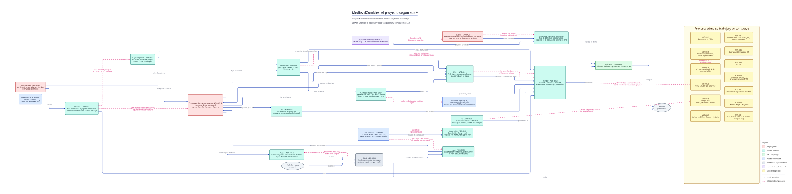

# Diagrama teórico del proyecto

> **Es teórico.** Muestra lo que se decidió en los ADRs aceptados, no el código: todavía
> no existe. Por eso no es un diagrama técnico del
> [ADR-0030](../../adr/0030-diagramas-tecnicos.md). De sus verificadores solo le toca
> (b): que el SVG coincida con su `.d2` regenerado. Los demás leen el código, la
> leyenda común o los links entre niveles, y este diagrama no tiene ninguno de los tres.

El proyecto completo en una sola mirada: cada pieza del engine y del juego con lo que
eligió su ADR, cómo se conectan las piezas y qué decisiones empujaron a otras. Sirve
para recordar lo decidido y para recorrerlo explicando cada decisión. El detalle de cada
una está en su ADR, en el [índice](../../README.md#índice-de-adrs).



## Cómo se lee

- **A la izquierda, el engine y el juego.** Las piezas no se agrupan por capa: el layout
  las ordena según el flujo de los datos, del teclado a la pantalla, para que un frame se
  pueda seguir con el dedo. **La capa de cada pieza (ADR-0012) la dice su color.** El
  núcleo (`engine/core`) lo usan todas las piezas, así que esas flechas no se dibujan.
- **A la derecha, la franja de proceso:** las decisiones sobre cómo se trabaja y se
  construye el proyecto, que no son piezas del engine.
- **Dos tipos de flecha,** las dos de una sola dirección:

| Flecha | Qué dice | Ejemplo |
|---|---|---|
| Continua | **Le entrega datos a:** la pieza de origen produce algo que la de destino usa | Animación → Render: "paleta de huesos" |
| Punteada, rosada | **Esta decisión empujó a esa:** lo que eligió un ADR obligó o llevó a lo que eligió otro. Solo las que dicen los ADRs (en su contexto o en sus fe de erratas) | ADR-0020 → Render: "640×360 deja el render limitado por los vértices: forward sin prepass" |

| Color | Capa |
|---|---|
| Rojo | Juego (`game/`) |
| Turquesa | Sistemas (`engine/`) |
| Verde | GPU (`engine/gpu`) |
| Azul | Núcleo (`engine/core`) |
| Gris | Plataforma (`engine/platform`) |
| Violeta | Herramienta del build (`tools/`) |
| Amarillo | Decisión de proceso |

## Cuándo se actualiza

En el PR que acepta un ADR: se agrega su caja (o se corrige la que cambió) y las
flechas que el ADR nombra. Una fe de erratas que cambia lo que eligió un ADR también
corrige su caja.

## Cómo se dibuja

Usa D2, la misma herramienta y versión que los diagramas técnicos (ADR-0030 y ADR-0029),
pero importa su propia leyenda, [`leyenda.d2`](leyenda.d2), porque sus elementos (piezas,
capas, decisiones) no son los de la leyenda común. El `.d2` es la fuente y el SVG, su
derivado. Se regenera con:

```sh
d2 --layout elk --dark-theme 200 proyecto.d2 proyecto.svg
```
