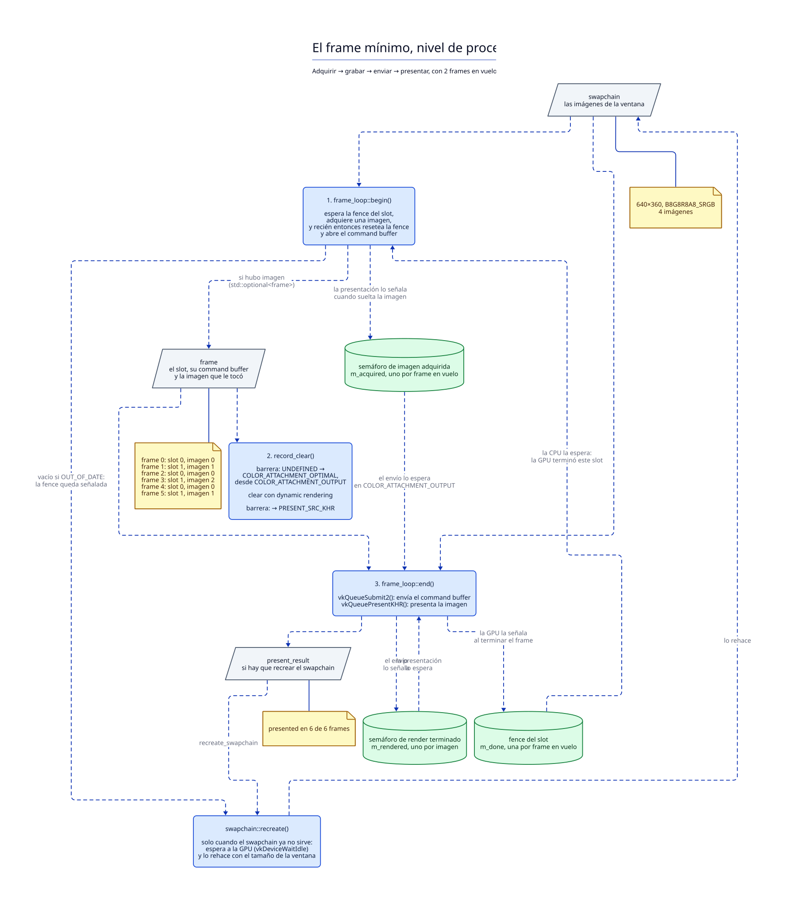

# Diagramas de gráficos

Los diagramas de los sistemas y procesos de `engine/gpu` y del renderer, tal como están
construidos. Las reglas y la leyenda están en
[`docs/diagramas/`](../../diagramas/README.md), el nivel de arriba
([ADR-0030](../../adr/0030-diagramas-tecnicos.md)).

## El frame mínimo (proceso)

Lo que hace cada vuelta del juego para pintar la ventana de un color: adquirir una imagen
del swapchain, grabar el clear, enviarlo y presentarlo, con 2 frames en vuelo. Muestra
también qué espera y qué señala cada paso: la fence de cada frame en vuelo, el semáforo de
imagen adquirida (uno por frame en vuelo) y el de render terminado (uno por imagen).

Fuente: [`frame-minimo.d2`](frame-minimo.d2). El ejemplo,
[`frame-minimo.ejemplo.d2`](frame-minimo.ejemplo.d2), lo escribe el test
`FrameLoopTest.WritesTheDiagramExample` (`tests/gpu/frame_test.cpp`) con lavapipe y la
ventana offscreen, y lo compara con el de esta carpeta (cómo funciona, en
[`docs/diagramas/`](../../diagramas/README.md#el-ejemplo-de-un-diagrama-de-proceso)).

**Lo que se lee en el diagrama:**

- **La fence y los semáforos.** La fence la espera la CPU (en `begin()`) y la señala la
  GPU: sincroniza la CPU con la GPU. Los semáforos los esperan y los señalan la GPU y la
  presentación: sincronizan trabajo de la GPU entre sí, sin que la CPU se entere.
- **Por qué el de render terminado va por imagen.** La presentación no tiene fence: lo
  único que dice que ya lo esperó es que su imagen vuelve a salir de
  `vkAcquireNextImageKHR`. El ejemplo muestra que el slot y la imagen no van juntos: los
  slots se turnan, pero el orden de las imágenes lo elige el driver.
- **El orden de `begin()`.** La fence se resetea recién cuando hay imagen: si la
  adquisición da `OUT_OF_DATE`, la fence sigue señalada, y la próxima vuelta no espera
  algo que nadie va a señalar.
- **Las dos salidas a `swapchain::recreate()`:** `begin()` vacío (`OUT_OF_DATE` al
  adquirir) y `present_result::recreate_swapchain` (`OUT_OF_DATE` o `SUBOPTIMAL` al
  presentar, o una imagen que llegó `SUBOPTIMAL`). El juego recrea también con el evento
  `resized`, porque en Wayland cambiar el tamaño no hace que la presentación avise.
- **La primera barrera parte de `COLOR_ATTACHMENT_OUTPUT`,** la misma etapa en la que el
  envío espera el semáforo de imagen adquirida. Así queda encadenada a esa espera, y la
  transición de layout no ocurre mientras la pantalla todavía lee la imagen.
