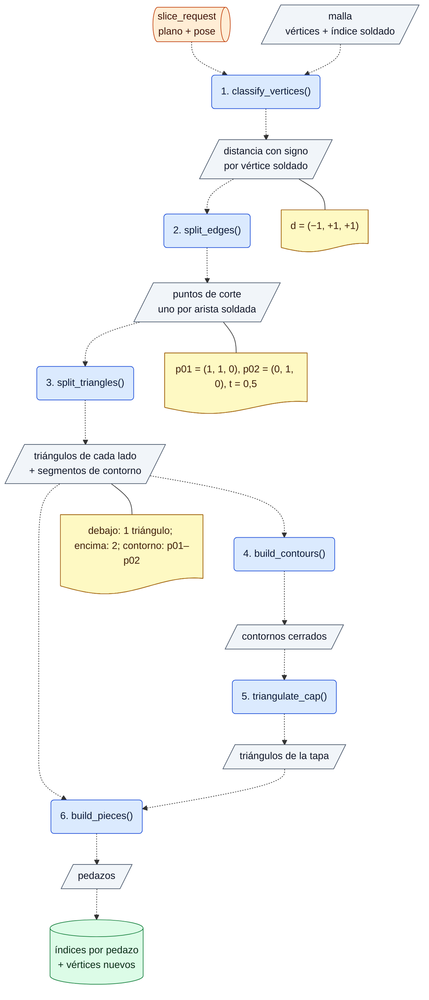
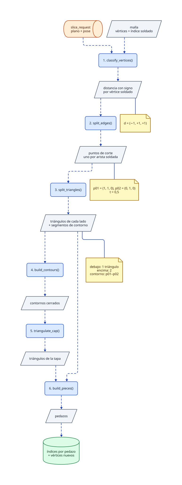
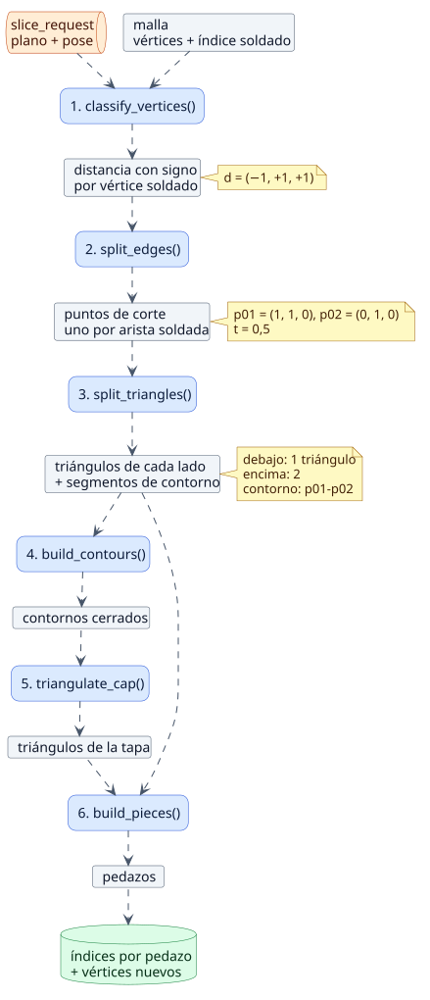
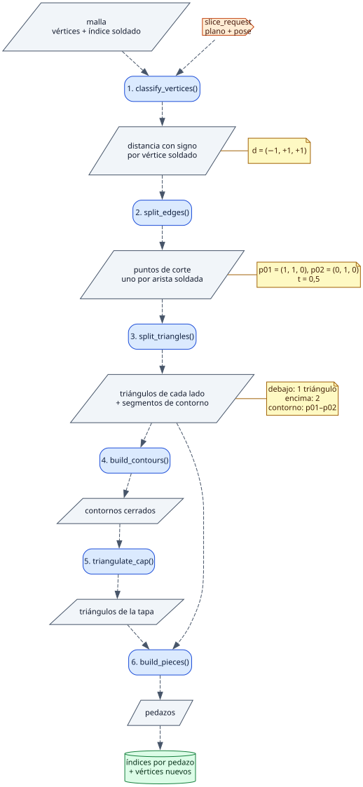

# Piloto de diagramas (ADR-0030, #60)

Material de investigación del ADR-0030: **un solo diagrama, el del corte de una malla**,
dibujado en cuatro formatos para compararlos en GitHub.

> **Diagrama teórico, guardado como historial.** Cuando se hizo no existía código: los
> nombres de funciones y datos son ilustrativos (salen del ADR-0007) y no son una API
> decidida. El diagrama real del corte nace con su código, en `docs/slicing/diagramas/`.

## El ejemplo que recorre el diagrama

- Plano del corte: `y = 1`, normal `n = (0, 1, 0)`.
- Triángulo: `v0 = (0, 0, 0)`, `v1 = (2, 2, 0)`, `v2 = (0, 2, 0)`.
- Distancias con signo: `d = (−1, +1, +1)`.
- Cruzan el plano las aristas `v0–v1` y `v0–v2`, con `t = 0,5`:
  `p01 = (1, 1, 0)` y `p02 = (0, 1, 0)`.
- Resultado: 1 triángulo debajo (`v0, p01, p02`), 2 encima (`v1, v2, p02` y
  `v1, p02, p01`) y 1 segmento de contorno (`p01–p02`) para la tapa.

## Leyenda de prueba

| Elemento | Forma | Color (repite lo que dice la forma) |
|---|---|---|
| Función | rectángulo redondeado, con su número de orden y `()` | azul |
| Dato en la CPU | paralelogramo | gris |
| Cola de eventos | cilindro horizontal | naranjo |
| Recurso de la GPU | cilindro | verde |
| Ejemplo concreto | nota | amarillo |
| Dato que entra o sale de una función | flecha punteada | — |
| Ejemplo de un dato | línea sin flecha | — |

## Mermaid

GitHub lo renderiza directamente desde este texto.

## D2

Fuente: [`corte.d2`](corte.d2), con la leyenda importada de [`leyenda.d2`](leyenda.d2).

## PlantUML

Fuente: [`corte.puml`](corte.puml), con la leyenda incluida de [`leyenda.iuml`](leyenda.iuml).

## Graphviz (DOT)

Fuente: [`corte.dot`](corte.dot). DOT no tiene forma de importar estilos: la leyenda se
repite en cada archivo.

