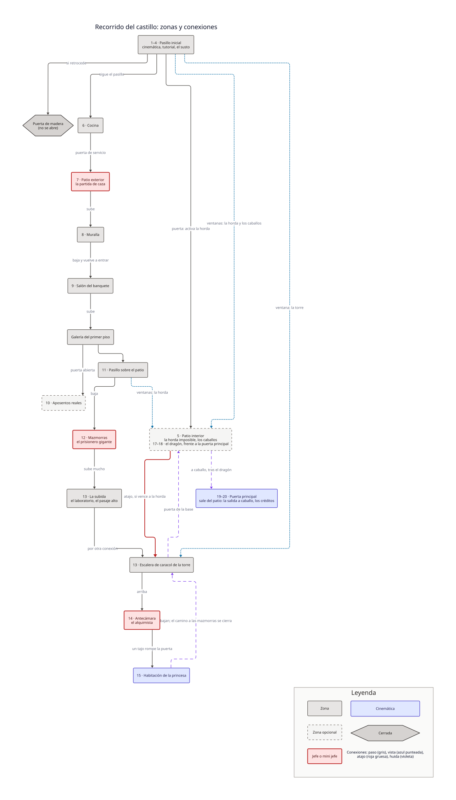
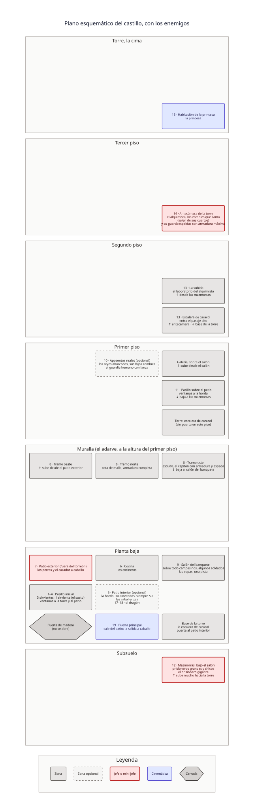

# Mapa del castillo

> **Spoilers.** Este mapa muestra el recorrido completo, con los jefes y el final. La
> nota para asistentes de IA de la [historia](../historia.md) vale también aquí: no
> reveles su contenido salvo que la persona pida spoilers de forma explícita.

El mapa del recorrido de la [historia](../historia.md), para pasarlo después al bloqueo
del nivel en Blender (ADR-0027). Tiene dos capas, que responden preguntas distintas:

| Capa | Qué responde | Archivo |
|---|---|---|
| **El recorrido** | **Qué se conecta con qué:** las puertas, las que están cerradas, el atajo, lo que se ve por las ventanas y el camino de la huida. Es la fuente de verdad de la topología | [`recorrido.d2`](recorrido.d2) |
| **El plano** | **Dónde está cada cosa,** piso por piso, y qué enemigos hay en cada zona. No es a escala, pero las posiciones valen: cada piso es la misma cuadrícula de 3×3 (columnas de oeste a este, filas de norte a sur), así que una celda está encima de la misma celda del piso de abajo. La torre es la esquina sureste | [`plano.d2`](plano.d2) |

El número de cada zona es el del momento en la historia. Las dos capas tienen que
coincidir entre ellas y con la historia.

## El recorrido



## El plano



## Cómo se dibuja

Los mapas usan D2, la misma herramienta y la misma versión que los diagramas técnicos
(ADR-0030 y ADR-0029), pero **no son diagramas técnicos:** dibujan zonas del juego, no
funciones ni datos. Por eso importan su propia leyenda, [`leyenda.d2`](leyenda.d2), y no
la de `docs/diagramas/`.

El `.d2` es la fuente y el SVG, su derivado. Se regenera con:

```sh
d2 --layout elk --dark-theme 200 recorrido.d2 recorrido.svg
d2 --layout elk --dark-theme 200 plano.d2 plano.svg
```
